# Overview

`stats2data` simulates raw datasets whose summary statistics match reported
summary statistics (the *targets*). Each module defines an objective, the
discrepancy between the summary statistics of a candidate dataset and the
targets, and minimizes it with simulated annealing. A run stops once the best
objective value falls below the convergence threshold `thresh` or once the
iteration budget is spent. In this vignette, a run whose best objective value
is below `thresh` is called *converged*.

Convergence is a statement about the optimization only: the simulated
summary statistics reproduce the targets to within `thresh`. Many different
datasets share the same summary statistics, and a simulated dataset is one of
them. The results below are therefore described in terms of the optimization
(objective values, target-vs-simulated differences, run-to-run variability),
not in terms of how closely the simulated data resemble the unobserved
original data.

The vignette works through four examples:

1. the **Descriptives module** (`optim_vec()`), using the reported marginal
   statistics of Bardwell et al. (2007);
2. the **MLR module** (`optim_mlr()`), using the reported correlations and
   regression estimates of the same study;
3. the **ANOVA module** (`optim_aov()`), using the reported cell means and
   F-statistics of Reynolds and Besner (2008), as in the accompanying
   manuscript;
4. the **parallel workflow** (`parallel_optim()`), using the ANOVA example.

Across the examples, the following functions are demonstrated:

* the optimization functions `optim_vec()`, `optim_mlr()`, `optim_aov()`, and
  `parallel_optim()`;
* the GRIM check `check_grim()`;
* the inspection methods `print()`, `summary()`, `get_stats()`, `get_rmse()`,
  and `coef()`;
* the plotting functions `plot_convergence()`, `plot_cooling()`, `plot_fit()`,
  `plot_stability()`, and the `plot()` methods;
* the Shiny interface `run_app()`.

## Installation


``` r
if (!requireNamespace("devtools", quietly = TRUE)) install.packages("devtools")
devtools::install_github("sebastian-lortz/stats2data")
```

## Shiny interface

All three modules and the parallel workflow are also available in a
point-and-click interface:


``` r
library(stats2data)
run_app()
```

The tabs *Descriptives*, *ANOVA*, and *Linear Regression* correspond to
`optim_vec()`, `optim_aov()`, and `optim_mlr()`. The inputs of each tab
correspond to the arguments of the function (the info icon of each input
names the argument), and setting *Number of Runs* above one calls
`parallel_optim()`. The results panel offers the plots and summaries shown in
this vignette. The *Download* button exports the result object, the simulated
data, and the R code of the function call, which reproduces the result in R.

## Setup


``` r
library(stats2data)
library(ggplot2)
```

# 1. Descriptives module: Bardwell et al. (2007)

Bardwell et al. (2007, <https://doi.org/10.1016/j.jad.2006.06.013>) examined
whether depressive symptoms or apnea severity better predict fatigue in
patients with obstructive sleep apnea. The raw data are not publicly
available. The study reports means and standard deviations of four variables
for `N = 60` patients, rounded to one decimal. `optim_vec()` simulates one
vector per variable that reproduces its target mean and SD.

## 1.1 Encoding the targets


``` r
N           <- 60
target_mean <- c(Apnea.1 = 48.8, Apnea.2 = 17.3, Depression = 12.6, Fatigue = 10.8)
target_sd   <- c(Apnea.1 = 27.1, Apnea.2 = 20.1, Depression = 11.3, Fatigue = 7.3)
integer     <- c(FALSE, FALSE, TRUE, TRUE)
range       <- matrix(
  c( 15,    0,  0,  0,    # lower bounds
    111, 80.9, 49, 28),   # upper bounds
  nrow = 2, byrow = TRUE
)
```

`Apnea.1` and `Apnea.2` are treated as continuous, `Depression` and `Fatigue`
as integer-valued sum scores. `range` holds one column of lower and upper
bounds per variable.

## 1.2 GRIM check

For integer-valued data, not every mean is attainable: the sum of `N`
integers divided by `N` can only take values on a grid of width `1 / N`. The
GRIM test (Brown & Heathers, 2017) checks whether a reported mean, rounded to
`decimals`, lies on that grid:


``` r
check_grim(n = N, target_mean = target_mean[["Depression"]], decimals = 1)
#> $test
#> [1] TRUE
#> 
#> $grim_mean
#> [1] 12.6
check_grim(n = N, target_mean = target_mean[["Fatigue"]],    decimals = 1)
#> $test
#> [1] TRUE
#> 
#> $grim_mean
#> [1] 10.8
```

With `N = 60` and one decimal, the grid width (`1 / 60`) is smaller than the
rounding unit (`0.1`), so every mean passes. The check is informative for
small samples or more decimals; for a mean that fails, `grim_mean` returns
the nearest attainable mean (hypothetical values):


``` r
check_grim(n = 7, target_mean = 3.45, decimals = 2)
#> $test
#> [1] FALSE
#> 
#> $grim_mean
#> [1] 3.43
```

## 1.3 Running the optimizer

For continuous variables, `optim_vec()` starts from a vector whose mean lies
within `thresh` of the target mean and anneals the values toward the target
SD; the moves keep the mean fixed. For integer variables, it draws a
distribution from SPRITE (Heathers et al., 2018) via `rsprite2` whose mean and
SD match the targets at the number of decimals given by `sprite_prec`. The
objective of each variable is the absolute difference between its simulated
and target SD.

Both statistics are reported to one decimal, so `sprite_prec = c(1, 1)`, and
`thresh = 0.05` is set to half a unit of the last reported decimal. All other
arguments are at their defaults (`max_iter = 5e5`, `init_temp = 1e-3`,
`cooling_rate = NULL`, i.e. `(max_iter - 10) / max_iter`, `max_starts = 3`).


``` r
set.seed(2026)
result_vec <- optim_vec(
  N           = N,
  target_mean = target_mean,
  target_sd   = target_sd,
  range       = range,
  integer     = integer,
  sprite_prec = c(1, 1),
  thresh      = 0.05
)
```

## 1.4 Inspecting the result

`print()` shows the sample size and the best objective value per variable:


``` r
result_vec
#> stats2data Descriptives result
#>   Variables: 4 
#>   N:         60 
#>   Best objective per variable:
#>     Apnea.1: 0.04797
#>     Apnea.2: 0.04888
#>     Depression: 0.02264
#>     Fatigue: 0.04108
```

The best objective values are
below `thresh = 0.05` for all four
variables. `summary()` adds the target and simulated means and SDs and their
RMSEs; the largest absolute difference between a simulated and a target mean
is 0.0497:


``` r
summary(result_vec)
#> stats2data Descriptives Summary
#> -----------------------------------------------
#> N: 60  | Variables: 4 
#> 
#> Best objective per variable:
#>   Apnea.1: 0.04797
#>   Apnea.2: 0.04888
#>   Depression: 0.02264
#>   Fatigue: 0.04108
#> 
#> RMSE
#>   Means: 0.03875 
#>   SDs:   0.0415 
#> 
#> Target vs. Simulated:
#>    variable target_mean sim_mean target_sd sim_sd
#>     Apnea.1        48.8    48.75      27.1 27.052
#>     Apnea.2        17.3    17.35      20.1 20.051
#>  Depression        12.6    12.63      11.3 11.323
#>     Fatigue        10.8    10.80       7.3  7.341
```

`get_stats()` returns the simulated statistics and `get_rmse()` the RMSEs
between simulated and target statistics:


``` r
get_stats(result_vec)
#> $mean
#>    Apnea.1    Apnea.2 Depression    Fatigue 
#>   48.75073   17.34969   12.63333   10.80000 
#> 
#> $sd
#>    Apnea.1    Apnea.2 Depression    Fatigue 
#>  27.052032  20.051124  11.322644   7.341085
get_rmse(result_vec)
#> $rmse_mean
#> [1] 0.03875487
#> 
#> $rmse_sd
#> [1] 0.04150452
```

If SPRITE finds no distribution for an integer variable, the reason is stored
per variable in `error_msgs` (`NULL` when SPRITE succeeded):


``` r
result_vec$error_msgs
#> [[1]]
#> NULL
#> 
#> [[2]]
#> NULL
#> 
#> [[3]]
#> NULL
#> 
#> [[4]]
#> NULL
```

## 1.5 Diagnostics

`plot_convergence()` shows the best objective value across iterations. For a
`stats2data_vec` result, `run` selects the variable; `Apnea.2` is the second
variable. `log_y = TRUE` uses a logarithmic y axis, and the shaded band marks
the region below `thresh`.


``` r
plot_convergence(result_vec, run = 2, log_y = TRUE)
```

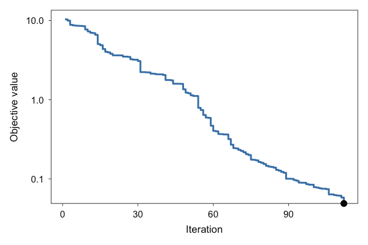

The trajectory has 112 iterations.
Integer variables are drawn by SPRITE without annealing, so their trajectory
consists of a single value.

`plot_cooling()` shows the temperature schedule implied by `init_temp`,
`cooling_rate`, and `max_iter`:


``` r
plot_cooling(result_vec)
```

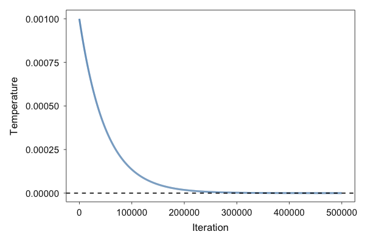

## 1.6 Target vs. simulated statistics

`plot_fit()` plots the difference between simulated and target statistics.
With `standardised = FALSE`, the differences are on the original scale; the
shaded band marks `+/- thresh`. `order = "fit"` sorts the statistics by
absolute difference.


``` r
plot_fit(result_vec, standardised = FALSE, order = "fit")
```

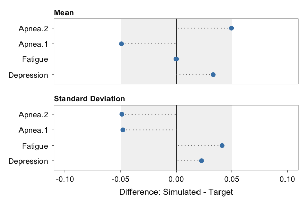

The same plots are available through `plot()`, with `which` selecting the
panel:


``` r
plot(result_vec)                    # plot_convergence()
plot(result_vec, which = "cooling") # plot_cooling()
plot(result_vec, which = "fit")     # plot_fit()
```

## 1.7 Simulated data

The simulated data are stored in `result_vec$data`, one column per variable:


``` r
data_vec <- result_vec$data
head(data_vec)
#>    Apnea.1    Apnea.2 Depression Fatigue
#> 1 75.77349 18.2021350          8      14
#> 2 62.38032 11.3144337         19      20
#> 3 18.60938  2.7516503         15       7
#> 4 53.29988 26.4374525         16       9
#> 5 56.48064 40.9638859          5      21
#> 6 24.81849  0.1944602         25       6

data_long <- data.frame(
  variable = factor(rep(names(data_vec), each = nrow(data_vec)), levels = names(data_vec)),
  value    = unlist(data_vec, use.names = FALSE)
)
ggplot(data_long, aes(x = value)) +
  geom_histogram(bins = 15, fill = "grey60", colour = "grey20") +
  facet_wrap(~ variable, scales = "free") +
  labs(x = NULL, y = "Count") +
  theme_minimal()
```

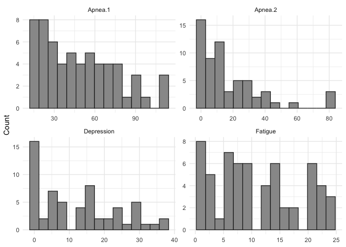

# 2. MLR module: Bardwell et al. (2007)

Bardwell et al. (2007) also report a multiple linear regression of `Fatigue`
on the two apnea indices and `Depression`, with coefficients, standard
errors, and the correlations of each predictor with `Fatigue`. `optim_mlr()`
simulates data that reproduce these targets together with the marginal
statistics from Section 1.

## 2.1 Encoding the targets


``` r
reg_equation <- "Fatigue ~ Apnea.1 + Apnea.2 + Depression"
target_reg   <- c("(Intercept)" = 4.020, Apnea.1 = 0.023, Apnea.2 = 0.008, Depression = 0.438)
target_se    <- c(NA, 0.034, 0.048, 0.066)
target_cor   <- c(NA, NA, NA, 0.11, 0.20, 0.68)
```

`target_reg` and `target_se` follow the terms of `reg_equation`, intercept
first. `target_cor` holds the upper triangle of the correlation matrix of all
variables in `target_mean`, filled column by column in the order of
`target_mean`: `Apnea.1-Apnea.2`, `Apnea.1-Depression`, `Apnea.2-Depression`,
`Apnea.1-Fatigue`, `Apnea.2-Fatigue`, `Depression-Fatigue`. `NA` marks
statistics that were not reported; they are excluded from the objective.

## 2.2 Running the optimizer

`optim_mlr()` first calls `optim_vec()` to simulate the marginals and then
reorders the values of the predictors with simulated annealing, followed by
hill climbing (`hill_climbs`). The objective is
`weight * correlation error + (1 - weight) * regression error`, where the
regression error includes the standard errors when `target_se` is given.

The call uses `thresh = 0.001`, `sprite_prec = c(1, 1)` as in Section 1, and
the defaults otherwise (`weight = 0.5`, `max_iter = 1e5`, `max_starts = 3`,
`hill_climbs = 1e4`; `init_temp = NULL` is calibrated from the objective
changes of random swaps, `cooling_rate = NULL` is `(max_iter - 10) / max_iter`).


``` r
set.seed(2026)
result_mlr <- optim_mlr(
  N            = N,
  target_mean  = target_mean,
  target_sd    = target_sd,
  range        = range,
  integer      = integer,
  sprite_prec  = c(1, 1),
  reg_equation = reg_equation,
  target_cor   = target_cor,
  target_reg   = target_reg,
  target_se    = target_se,
  thresh       = 0.001
)
```

## 2.3 Inspecting the result


``` r
result_mlr
#> stats2data MLR result
#>   N:          60 
#>   Equation:   Fatigue ~ Apnea.1 + Apnea.2 + Depression 
#>   Best objective: 0.00225996
```

The best objective value is 0.00226, which is
not below `thresh = 0.001`.


``` r
summary(result_mlr)
#> stats2data MLR Summary
#> -----------------------------------------------
#> N: 60  | Model: Fatigue ~ Apnea.1 + Apnea.2 + Depression 
#> Best objective: 0.00225996 
#> 
#> RMSE
#>   Correlations:             0.00002284 
#>   Regression Coefficients:  0.0003972 
#>   Standard Errors:          0.006854 
#> 
#> Descriptives (Target vs. Simulated):
#>    variable target_mean sim_mean target_sd sim_sd
#>     Apnea.1        48.8    48.80      27.1 27.099
#>     Apnea.2        17.3    17.30      20.1 20.099
#>  Depression        12.6    12.60      11.3 11.283
#>     Fatigue        10.8    10.82       7.3  7.347
#> 
#> Coefficients (Target vs. Simulated):
#>         term target_reg  sim_reg target_se  sim_se
#>  (Intercept)      4.020 4.020297        NA 1.65638
#>      Apnea.1      0.023 0.023138     0.034 0.02754
#>      Apnea.2      0.008 0.008704     0.048 0.03809
#>   Depression      0.438 0.437831     0.066 0.06500
#> 
#> Correlations (Target vs. Simulated):
#>                pair target_cor sim_cor
#>     Apnea.1-Apnea.2         NA 0.28831
#>  Apnea.1-Depression         NA 0.02649
#>  Apnea.2-Depression         NA 0.22546
#>     Apnea.1-Fatigue       0.11 0.11001
#>     Apnea.2-Fatigue       0.20 0.20000
#>  Depression-Fatigue       0.68 0.67996
```

`get_stats()` returns the fitted `lm` object, the coefficients, standard
errors, correlations (upper triangle in the order predictors, outcome), means,
and SDs of the simulated data. `coef()` refits the regression and returns the
coefficients:


``` r
stats_mlr <- get_stats(result_mlr)
names(stats_mlr)
#> [1] "model" "reg"   "se"    "cor"   "mean"  "sd"
summary(stats_mlr$model)
#> 
#> Call:
#> stats::lm(formula = frm, data = d)
#> 
#> Residuals:
#>      Min       1Q   Median       3Q      Max 
#> -13.1641  -3.0217  -0.8974   4.5710  11.1889 
#> 
#> Coefficients:
#>             Estimate Std. Error t value      Pr(>|t|)    
#> (Intercept) 4.020297   1.656380   2.427        0.0185 *  
#> Apnea.1     0.023138   0.027536   0.840        0.4043    
#> Apnea.2     0.008704   0.038093   0.228        0.8201    
#> Depression  0.437831   0.065002   6.736 0.00000000945 ***
#> ---
#> Signif. codes:  0 '***' 0.001 '**' 0.01 '*' 0.05 '.' 0.1 ' ' 1
#> 
#> Residual standard error: 5.484 on 56 degrees of freedom
#> Multiple R-squared:  0.4713,	Adjusted R-squared:  0.443 
#> F-statistic: 16.64 on 3 and 56 DF,  p-value: 0.0000000752
coef(result_mlr)
#> (Intercept)     Apnea.1     Apnea.2  Depression 
#> 4.020297185 0.023137936 0.008703818 0.437831483
get_rmse(result_mlr)
#> $rmse_cor
#> [1] 0.00002283587
#> 
#> $rmse_reg
#> [1] 0.00039721
#> 
#> $rmse_se
#> [1] 0.006854068
```

The marginal result of the internal `optim_vec()` call is stored in
`result_mlr$optim_vec` and supports the methods of Section 1:


``` r
get_rmse(result_mlr$optim_vec)
#> $rmse_mean
#> [1] 0.008362809
#> 
#> $rmse_sd
#> [1] 0.02522139
```

## 2.4 Diagnostics

`plot_convergence()` shows the best objective value across the annealing
iterations; `first_iter` skips leading iterations, here the first 10%:


``` r
n_iter_mlr <- length(result_mlr$track_objective)
plot_convergence(result_mlr, log_y = TRUE, first_iter = floor(n_iter_mlr / 10))
```

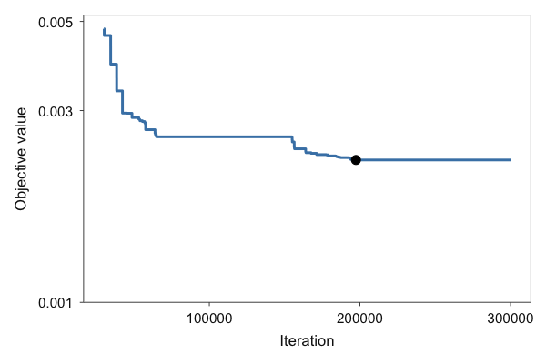

With `ratio = TRUE`, the plot shows the ratio of the correlation error to the
regression error of the best candidate, with lines at its mean, median, and
final value (`show_mean`, `show_median`, `show_final`). A ratio above 1 means
that the correlation component is the larger of the two.


``` r
plot_convergence(result_mlr, ratio = TRUE)
```

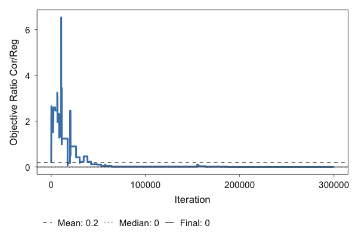

The final ratio is 0.00509.

`plot_cooling()` uses the stored `init_temp` and `cooling_rate`, i.e. the
values calibrated during the run:


``` r
result_mlr$inputs$init_temp
#> [1] 0.03931238
plot_cooling(result_mlr)
```

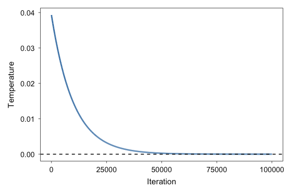

## 2.5 Balancing the objective with `weight`

`weight` sets how much the correlation and the regression components
contribute to the objective. Objective values obtained with different
weights are on different scales and are not compared directly; the
unweighted RMSEs of `get_rmse()` are. The optimization is repeated with
`weight = 0.1`:


``` r
set.seed(2026)
result_mlr_w01 <- optim_mlr(
  N            = N,
  target_mean  = target_mean,
  target_sd    = target_sd,
  range        = range,
  integer      = integer,
  sprite_prec  = c(1, 1),
  reg_equation = reg_equation,
  target_cor   = target_cor,
  target_reg   = target_reg,
  target_se    = target_se,
  thresh       = 0.001,
  weight       = 0.1
)
```


``` r
rbind(
  "weight = 0.5" = unlist(get_rmse(result_mlr)),
  "weight = 0.1" = unlist(get_rmse(result_mlr_w01))
)
#>                   rmse_cor     rmse_reg      rmse_se
#> weight = 0.5 0.00002283587 0.0003972100 0.0068540684
#> weight = 0.1 0.00194172165 0.0006876133 0.0009375174
```

The table shows how the RMSEs of the correlations, coefficients, and standard
errors change with `weight` in this example. Which balance is preferable
depends on which targets matter most for the intended use of the data. The
remainder of this section continues with the `weight = 0.5` result.

## 2.6 Target vs. simulated statistics


``` r
plot_fit(result_mlr, standardised = FALSE)
```

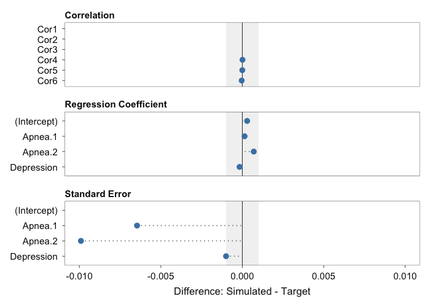

With the default `standardised = TRUE`, the differences are divided by the
target values (for targets of zero, the unstandardised difference is shown).
The `plot()` method offers the same panels, including `which = "ratio"`:


``` r
plot(result_mlr, which = "fit")
plot(result_mlr, which = "ratio")
```

## 2.7 Simulated data


``` r
data_mlr <- result_mlr$data
head(data_mlr)
#>     Apnea.1   Apnea.2 Depression Fatigue
#> 1  64.13553 17.754307         11      18
#> 2  17.86473 15.232345         15      14
#> 3 110.29750 17.351951          0      15
#> 4  29.09759 32.718223         16      11
#> 5  47.35261 14.904594         11       7
#> 6  28.03631  1.847764          9       6
round(cor(data_mlr), 2)
#>            Apnea.1 Apnea.2 Depression Fatigue
#> Apnea.1       1.00    0.29       0.03    0.11
#> Apnea.2       0.29    1.00       0.23    0.20
#> Depression    0.03    0.23       1.00    0.68
#> Fatigue       0.11    0.20       0.68    1.00
```

# 3. ANOVA module: Reynolds and Besner (2008)

This section follows the empirical example of the accompanying manuscript.
Reynolds and Besner (2008, Experiment 5) examined how contextual
predictability affects response times in word and nonword naming; the study
was among those replicated by the Open Science Collaboration (2015). To our
knowledge, the raw data are not publicly available.

## 3.1 Reported summary statistics

The study reports a 2 x 2 within-subjects design (`S = 16`) with four cell
means, indexed by stimulus type (`Factor1`) and switch condition (`Factor2`):
543, 536, 614, and 618 ms. It reports `MSE = 3070` for the `Factor1` effect,
`F(1, 15) = 30.5` (partial eta squared .670) for `Factor1`, and `F < 1` for
`Factor2` (.002) and the interaction (.015).

The code of this section is the code of the empirical example in the
manuscript, so it reproduces the results reported there.


``` r
S   <- 16
mse <- 3070
target_group_means <- c(543, 536, 614, 618)
eta2   <- c(0.002, 0.015)  # Factor2, Factor1:Factor2
df_err <- S - 1
```

The numerator mean squares implied by the cell means of the balanced 2 x 2
within-subjects design are:


``` r
m_cell  <- matrix(target_group_means, nrow = 2, byrow = TRUE)  # rows: Factor1, cols: Factor2
m_grand <- mean(m_cell)
ms_f1   <- S * 2 * sum((rowMeans(m_cell) - m_grand)^2)
ms_f2   <- S * 2 * sum((colMeans(m_cell) - m_grand)^2)
ms_int  <- S * sum((m_cell - outer(rowMeans(m_cell), colMeans(m_cell), "+") + m_grand)^2)
c(ms_f1 = ms_f1, ms_f2 = ms_f2, ms_int = ms_int)
#>  ms_f1  ms_f2 ms_int 
#>  93636     36    484
```

The reported `Factor1` statistics are consistent with each other: the implied
mean square divided by the reported `MSE` gives `F = 30.5`, and
`F / (F + df_error)` gives the reported partial eta squared of .670.


``` r
stopifnot(round(ms_f1 / mse, 1) == 30.5)
stopifnot(round(30.5 / (30.5 + df_err), 3) == 0.670)
```

For the two effects reported as `F < 1`, the F-statistics are set from the
reported partial eta squared via `F = eta^2 * df_error / (1 - eta^2)` (one
numerator degree of freedom). The modules require bounds for the outcome,
which the study does not report; the range of the reported cell means is
extended by four times `sqrt(MSE)`, the residual SD implied by the MSE, and
rounded outward. The summary statistics are encoded in one list of
`optim_aov()` arguments:


``` r
F_value_derived <- c(round(ms_f1 / mse, 1), round(eta2 * df_err / (1 - eta2), 3))

sumstats <- list(
  S                  = S,
  levels             = c(2, 2),
  factor_type        = c("within", "within"),
  formula            = "outcome ~ Factor1 * Factor2 + Error(ID / (Factor1 * Factor2))",
  integer            = FALSE,
  target_f_list      = list(
    effect  = c("Factor1", "Factor2", "Factor1:Factor2"),
    F_value = F_value_derived
  ),
  target_group_means = target_group_means,
  range              = c(floor(min(target_group_means) - 4 * sqrt(mse)),
                         ceiling(max(target_group_means) + 4 * sqrt(mse)))
)
sumstats$target_f_list$F_value
#> [1] 30.500  0.030  0.228
sumstats$range
#> [1] 314 840
```

`target_group_means` lists the cells with `Factor1` varying slowest (11, 12,
21, 22).

## 3.2 Simulating a dataset

`optim_aov()` is called with its default hyperparameters (`max_iter = 3e4`,
`thresh = 0.005`, `max_starts = 3`, `init_temp = 1e-3`, `cooling_rate = NULL`,
i.e. `(max_iter - 10) / max_iter`). The objective is the RMSE between the
simulated and target F-statistics.


``` r
set.seed(2026)
result_aov <- do.call(optim_aov, sumstats)
```

## 3.3 Inspecting the output


``` r
result_aov
#> stats2data ANOVA result
#>   Design:    2 x 2 (within, within)
#>   Subjects:   16 
#>   Effects:    Factor1, Factor2, Factor1:Factor2 
#>   Best objective: 0.00346117
```


The best objective value is 0.00346, which is
below `thresh = 0.005`. The best
objective value first fell below `thresh` at iteration 8493:


``` r
which(result_aov$track_objective < result_aov$inputs$thresh)[1]
#> [1] 8493
```


``` r
summary(result_aov)
#> stats2data ANOVA Summary
#> -----------------------------------------------
#> Design:     2 x 2 (within, within)
#> Subjects:   16 
#> Best objective: 0.00346117 
#> 
#> RMSE
#>   F-statistics: 0.003461 
#>   Group means:  0.0000000000009747 
#> 
#> -----------------------------------------------
#> F-values (Target vs. Simulated):
#>           effect target_F    sim_F
#>          Factor1   30.500 30.49911
#>          Factor2    0.030  0.02408
#>  Factor1:Factor2    0.228  0.22774
#> 
#> -----------------------------------------------
#> Group Means (Target vs. Simulated):
#>        cell target_mean sim_mean
#>  F1=1, F2=1         543      543
#>  F1=1, F2=2         536      536
#>  F1=2, F2=1         614      614
#>  F1=2, F2=2         618      618
```


The simulated F-statistics are
30.499, 0.024, 0.228 for `Factor1`,
`Factor2`, and `Factor1:Factor2` (targets 30.5, 0.030, 0.228); the F-statistic
RMSE is 0.003 and the cell-mean RMSE
0.000000000000975.

Before the annealing, `optim_aov()` may shift the target cell means by less
than `thresh` so that the means and F-statistics can be matched jointly. The
values used are stored in `adjusted_targets`:


``` r
result_aov$adjusted_targets
#> $group_means
#> [1] 543 536 614 618
#> 
#> $F_values
#> [1] 30.500  0.030  0.228
```

`get_stats()` returns the ANOVA table of the simulated data (fitted with
`afex`), the F-statistics, and the cell means; `get_rmse()` returns the two
RMSEs:


``` r
get_stats(result_aov)
#> $model
#> Anova Table (Type 3 tests)
#> 
#> Response: outcome
#>                 num Df den Df    MSE       F     ges     Pr(>F)    
#> Factor1              1     15 3070.1 30.4991 0.43050 0.00005852 ***
#> Factor2              1     15 1495.2  0.0241 0.00029     0.8788    
#> Factor1:Factor2      1     15 2125.2  0.2277 0.00389     0.6401    
#> ---
#> Signif. codes:  0 '***' 0.001 '**' 0.01 '*' 0.05 '.' 0.1 ' ' 1
#> 
#> $F_value
#> [1] 30.49911423  0.02407665  0.22773815
#> 
#> $mean
#> 1_1 1_2 2_1 2_2 
#> 543 536 614 618
get_rmse(result_aov)
#> $rmse_F
#> [1] 0.003461175
#> 
#> $rmse_mean
#> [1] 0.0000000000009746616
```

## 3.4 Diagnostic plots

The two panels of the manuscript figure are obtained with (`first_iter = 1`
skips the first iteration):


``` r
plot_convergence(result_aov, first_iter = 1, log_y = TRUE)
```

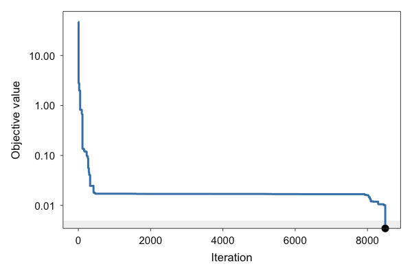


``` r
plot_fit(result_aov, standardised = FALSE)
```

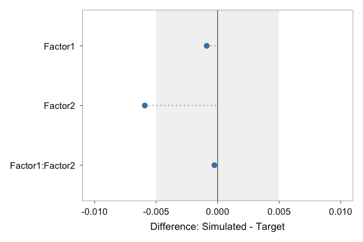

`show_best = FALSE` removes the marker of the best value and `thresh = NULL`
the shaded band:


``` r
plot_convergence(result_aov, show_best = FALSE, thresh = NULL)
```

`plot_cooling()` shows the temperature schedule:


``` r
plot_cooling(result_aov)
```

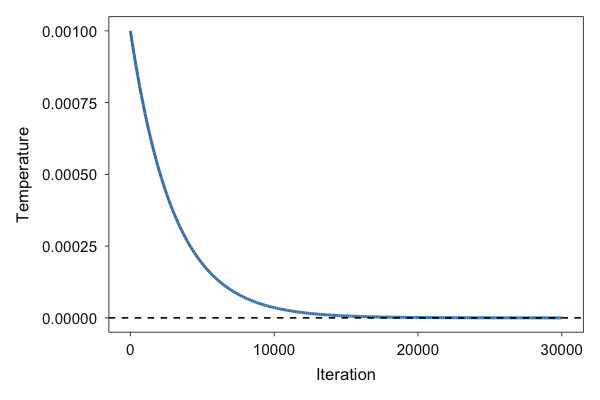

## 3.5 Simulated data

The data are stored in long format, one row per subject and cell. The
simulated observations lie within `range`; the second line checks whether any
observation equals one of the bounds:


``` r
range(result_aov$data$outcome)
#> [1] 469.2889 735.7955
any(result_aov$data$outcome %in% sumstats$range)
#> [1] FALSE

data_aov <- result_aov$data
head(data_aov)
#>   ID Factor1 Factor2  outcome
#> 1  1       1       1 526.5609
#> 2  1       1       2 594.2713
#> 3  1       2       1 641.5214
#> 4  1       2       2 551.0167
#> 5  2       1       1 535.8782
#> 6  2       1       2 549.8449
aggregate(outcome ~ Factor1 + Factor2, data = data_aov, FUN = mean)
#>   Factor1 Factor2 outcome
#> 1       1       1     543
#> 2       2       1     614
#> 3       1       2     536
#> 4       2       2     618

ggplot(data_aov, aes(x = interaction(Factor1, Factor2, sep = "-"), y = outcome)) +
  geom_jitter(width = 0.1, colour = "grey40") +
  stat_summary(fun = mean, geom = "point", shape = 4, size = 4) +
  labs(x = "Cell (Factor1-Factor2)", y = "Outcome") +
  theme_minimal()
```

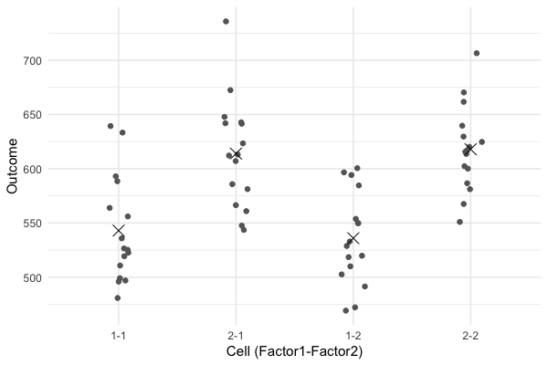

Crosses mark the simulated cell means.

# 4. Parallel workflow: Reynolds and Besner (2008)

Each run of an optimizer is subject to randomness, and many datasets share
the same summary statistics, so repeated runs return different datasets.
`parallel_optim()` repeats the optimization with the same arguments and
collects the runs. As in the manuscript, the ANOVA optimization is repeated
100 times on 6 parallel workers using `future::multisession` (Bengtsson,
2021); `seed` gives each run its own reproducible random-number stream.


``` r
result_parallel_aov <- parallel_optim(
  FUN   = optim_aov, # ANOVA module
  args  = sumstats,  # reported summary statistics
  runs  = 100,       # number of optimization runs
  cores = 6,         # number of parallel workers
  seed  = 2026,      # future.seed for parallel workers
  stop_conv = FALSE  # whether to stop once a run converges
)
```

`cores = 1` (the default) runs the replications sequentially; `cores > 1`
requires the packages `future` and `future.apply`. Because every run has its
own random-number stream derived from `seed`, the results do not depend on
`cores`.


## 4.1 Inspecting the parallel output


``` r
result_parallel_aov
#> stats2data parallel result
#>   Module: aov 
#>   Runs:   100 
#>   Best objective (across runs): 0.00106352 
#>   Mean objective (across runs): 0.0038539
```


100 of 100 runs have a best
objective value below `thresh` = 0.005. Across runs, the best
objective values range from 0.00106 to 0.00499,
and the simulated observations of all runs range from
358.1 to 765.9:


``` r
max(sapply(result_parallel_aov$results, function(x) x$best_objective)) < .005
#> [1] TRUE
sum(vapply(result_parallel_aov$results,
           function(r) r$best_objective < r$inputs$thresh, logical(1)))
#> [1] 100
range(unlist(lapply(result_parallel_aov$results, function(r) r$data$outcome)))
#> [1] 358.1386 765.8632
```

`summary()` lists the best and mean objective values, the RMSE against the
targets and between runs, and the target statistics aggregated across runs:


``` r
summary(result_parallel_aov)
#> stats2data Parallel Summary
#> -----------------------------------------------
#> Module: aov  | Runs: 100 
#> Best objective:  0.00106352 
#> Mean error:  0.0038539 
#> SD error:    0.00107989 
#> 
#> Target RMSE (across runs):
#>  metric     mean      sd      min      max
#>  rmse_F 0.003854 0.00108 0.001064 0.004993
#> 
#> Between-run RMSE:
#>  metric     mean       sd       min     max
#>  rmse_F 0.002037 0.001176 0.0003188 0.00747
#> 
#> Aggregated Statistics:
#>   F_value:
#>       mean   median       sd      min      max
#> 1 30.49988 30.50007 0.002090 30.49379 30.50390
#> 2  0.02439  0.02308 0.003290  0.02143  0.03728
#> 3  0.22786  0.22779 0.001234  0.22488  0.23112
#> 
#>   mean:
#>     mean median                 sd min max
#> 1_1  543    543 0.0000000000009403 543 543
#> 1_2  536    536 0.0000000000009664 536 536
#> 2_1  614    614 0.0000000000009346 614 614
#> 2_2  618    618 0.0000000000009585 618 618
```

`get_stats()` aggregates each statistic across runs (mean, median, SD,
minimum, maximum):


``` r
get_stats(result_parallel_aov)
#> $F_value
#>          mean      median          sd         min         max
#> 1 30.49988225 30.50006753 0.002090449 30.49379382 30.50390112
#> 2  0.02439294  0.02307733 0.003290052  0.02143349  0.03727947
#> 3  0.22786082  0.22779020 0.001233544  0.22487923  0.23112459
#> 
#> $mean
#>     mean median                    sd min max
#> 1_1  543    543 0.0000000000009403361 543 543
#> 1_2  536    536 0.0000000000009663550 536 536
#> 2_1  614    614 0.0000000000009345567 614 614
#> 2_2  618    618 0.0000000000009584873 618 618
```

`get_rmse()` returns two RMSEs per run and metric: `target_rmse`, against
the targets, and `between_rmse`, against the across-run mean of the simulated
statistics. The per-run values are in `raw`:


``` r
par_rmse$target_rmse
#>   metric        mean          sd        min         max
#> 1 rmse_F 0.003853902 0.001079895 0.00106352 0.004992881
par_rmse$between_rmse
#>   metric        mean          sd          min         max
#> 1 rmse_F 0.002036642 0.001175672 0.0003187576 0.007469883
```

The mean F-statistic RMSE against the targets is
0.00385 (maximum
0.00499); the mean run-to-run RMSE is
0.00204. The run-to-run RMSE quantifies how
much the simulated F-statistics vary between runs; it does not compare the
runs with the original data.

## 4.2 Stability and fit across runs

The two panels of the manuscript figure are `plot()`, which draws
`plot_stability()`, and `plot_fit()`. `plot_stability()` shows the
distributions of both RMSEs across runs, faceted by metric:


``` r
plot_stability(result_parallel_aov)
```

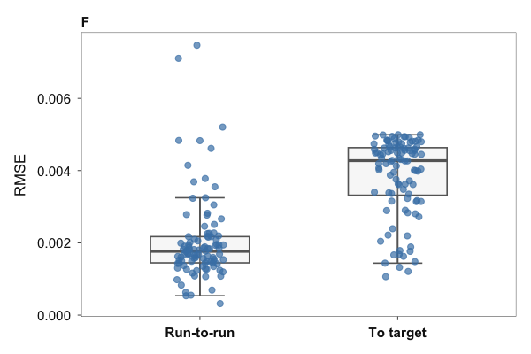

`plot_fit()` shows the across-run mean difference per statistic, with error
bars for the across-run range (`error_type = "range"`, default) or
`mean +/- SD` (`error_type = "sd"`); dots mark the individual runs.


``` r
plot_fit(
  result_parallel_aov,
  standardised = FALSE
)
```

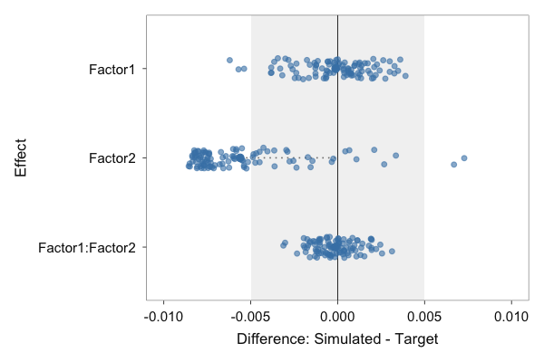


``` r
plot_fit(result_parallel_aov, standardised = FALSE, error_type = "sd")
```

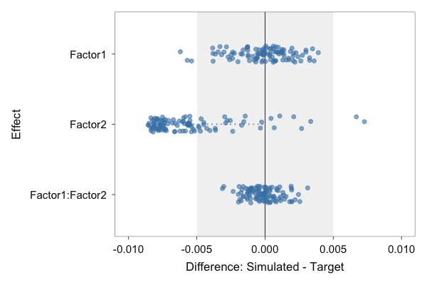

`plot()` draws `plot_stability()` by default (as in the manuscript script)
and `plot_fit()` with `which = "fit"`:


``` r
plot(result_parallel_aov)
plot(result_parallel_aov, which = "fit", standardised = FALSE)
```

## 4.3 Individual runs

The run with the lowest best objective value is stored in `best`; all runs
are in `results`. Both are ordinary `stats2data_aov` objects and support the
methods of Section 3:


``` r
result_parallel_aov$best
#> stats2data ANOVA result
#>   Design:    2 x 2 (within, within)
#>   Subjects:   16 
#>   Effects:    Factor1, Factor2, Factor1:Factor2 
#>   Best objective: 0.00106352
get_rmse(result_parallel_aov$best)
#> $rmse_F
#> [1] 0.00106352
#> 
#> $rmse_mean
#> [1] 0.0000000000009426415
head(result_parallel_aov$results[[2]]$data)
#>   ID Factor1 Factor2  outcome
#> 1  1       1       1 543.7920
#> 2  1       1       2 484.1879
#> 3  1       2       1 630.0790
#> 4  1       2       2 590.7470
#> 5  2       1       1 629.6518
#> 6  2       1       2 526.1276
```

## 4.4 Stopping at the first converged run

With `stop_conv = TRUE`, `parallel_optim()` stops launching runs once a run
has converged. With `cores > 1`, runs are dispatched in batches of `cores`,
so a whole batch completes before the check:


``` r
result_first_aov <- parallel_optim(
  FUN       = optim_aov,
  args      = sumstats,
  runs      = 12,
  cores     = 6,
  seed      = 2026,
  stop_conv = TRUE
)
```


``` r
result_first_aov
#> stats2data parallel result
#>   Module: aov 
#>   Runs:   6 of 12 (stopped early)
#>   Converged: TRUE (thresh = 0.005 )
#>   Best objective (across runs): 0.00317099 
#>   Mean objective (across runs): 0.00411833
```

6 of 12 requested
runs were completed.

# References

- Bardwell, W. A., Ancoli-Israel, S., & Dimsdale, J. E. (2007). Comparison of the effects of depressive symptoms and apnea severity on fatigue in patients with obstructive sleep apnea: A replication study. *Journal of Affective Disorders, 97*(1-3), 181-186. https://doi.org/10.1016/j.jad.2006.06.013
- Bengtsson, H. (2021). A unifying framework for parallel and distributed processing in R using futures. *The R Journal, 13*(2), 208-227. https://doi.org/10.32614/RJ-2021-048
- Brown, N. J. L., & Heathers, J. A. J. (2017). The GRIM test: A simple technique detects numerous anomalies in the reporting of results in psychology. *Social Psychological and Personality Science, 8*(4), 363-369. https://doi.org/10.1177/1948550616673876
- Heathers, J. A., Anaya, J., van der Zee, T., & Brown, N. J. L. (2018). Recovering data from summary statistics: Sample Parameter Reconstruction via Iterative TEchniques (SPRITE). *PeerJ Preprints, 6*, e26968v1. https://doi.org/10.7287/peerj.preprints.26968v1
- Open Science Collaboration. (2015). Estimating the reproducibility of psychological science. *Science, 349*(6251), aac4716. https://doi.org/10.1126/science.aac4716
- Reynolds, M., & Besner, D. (2008). Contextual effects on reading aloud: Evidence for pathway control. *Journal of Experimental Psychology: Learning, Memory, and Cognition, 34*(1), 50-64. https://doi.org/10.1037/0278-7393.34.1.50
